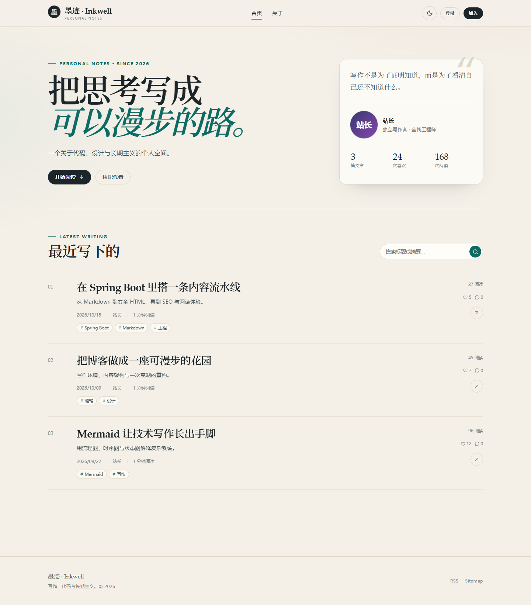

# 墨迹 · Inkwell

一个按《个人博客系统 PRD / TRD 一期（v1.1）》实现的前后端分离个人博客。后端为 Spring Boot 模块化单体，前端采用 **Nuxt 4 SSR**，兼顾阅读体验、SEO 与交互能力。

一期严格遵循文档 v1.1 的裁剪范围：**文章、登录、首页、个人空间、点赞、评论、@ 回复与站内通知**。视频与图片上传不在本期范围，图片使用外链。



> 预览：`http://localhost:3000`（本地演示账号 `admin` / `Admin@123456`）。更多界面见 `docs/screenshots/`。

## 1. 已实现能力

| 模块 | 实现 |
|---|---|
| 账户 | 用户名 + 密码注册/登录、BCrypt、JWT Access Token（2h）、一次性 Refresh Token（7d，轮换）、登出黑名单、博主初始化 |
| 首页 | SSR 文章流、游标分页、关键词搜索、文章卡片、响应式布局、深色主题 |
| 个人空间 | 资料、文章数/获赞/阅读统计、已发布/草稿/已下架 Tab、资料编辑、管理入口 |
| 文章 | Vditor Markdown 编辑器（所见即所得/分屏）、草稿、发布、下架、软删除、TOC、阅读量防刷、更新于 |
| 富格式 | GFM 表格、代码块 + highlight.js、Mermaid（懒渲染 + 失败降级）、KaTeX、图片 Lightbox、外链图片懒加载 |
| 互动 | 文章点赞、评论点赞、一级评论 + 二级回复、软删除占位、评论分页、展开更多回复 |
| @ 回复 | @ 用户联想、服务端生成结构化 mention、自动 @ 被回复人、回复/提及/文章评论通知、未读角标 |
| SEO | 服务端渲染、文章 OG/JSON-LD、canonical、`sitemap.xml`、`rss.xml`、`robots.txt` |

## 2. 技术架构

```text
Browser
   │
   ▼
Nuxt 4 SSR (Vue 3 + Pinia + Vditor)  ── REST /api ──►  Spring Boot 3.5 (Java 17)
   │                                                        │
   │ Nitro routes: sitemap / rss / robots                    ├─ Spring Security + JWT
   ▼                                                        ├─ Markdown 安全渲染管线
Nginx (compose) ── /api ────────────────────────────────────►├─ MyBatis + XML SQL
                                                            ├─ MySQL 8.4
                                                            └─ Redis 7.4
```

- **前端**：Nuxt 4.6 / Vue 3.5 / TypeScript / Pinia / Vditor 3。选择 SSR 而非纯 SPA，是为了让文章正文、标题和 OG 标签直接出现在首屏 HTML 中，符合博客的 SEO 需求；管理端页面仍然保持 SPA 式交互。
- **后端**：Spring Boot 3.5.6、Java 17、Spring Security、MyBatis 3.0.5、Flyway。按业务分包，不引入微服务复杂度，保留后续拆分空间。
- **数据库**：MySQL 8.4；SQL 全部集中在 `backend/src/main/resources/mapper/*.xml`，Service 不拼接 SQL。
- **缓存/会话辅助**：Redis 7.4 存 Refresh Token、Access Token 黑名单、阅读防刷和接口限流；本地开发用内存实现，无需安装 Redis。
- **部署**：Docker Compose + Nginx；Nginx 同源代理 `/api`，避免跨域与 Cookie 问题。

## 3. 目录

```text
.
├── backend/                       # Spring Boot
│   ├── src/main/java/com/blog/
│   │   ├── auth/                  # 认证接口 + impl
│   │   ├── user/                  # 用户接口 + impl + UserViewMapper
│   │   ├── article/               # 文章接口 + impl + ArticleViewAssembler + MarkdownRenderer
│   │   ├── interaction/           # 点赞、评论接口 + impl + CommentViewAssembler
│   │   ├── notification/          # 通知接口 + impl + NotificationViewAssembler
│   │   ├── common/                # 统一返回、异常、游标分页、Redis 抽象、限流
│   │   ├── config/                # Security、属性、启动初始化
│   │   └── security/              # JWT、过滤器、Principal
│   └── src/main/resources/
│       ├── mapper/                # 全部 MyBatis XML
│       └── db/migration/          # Flyway V1
├── frontend/                      # Nuxt 4 SSR
│   ├── app/pages/                 # 首页/文章/空间/登录/编辑/管理/通知
│   ├── app/components/            # 编辑器、评论树、Markdown 渲染增强
│   ├── app/composables/           # useApi / useAuth / useTheme / useToast
│   ├── server/routes/             # sitemap.xml / rss.xml / robots.txt
│   └── scripts/ui-smoke.mjs       # Playwright 视觉冒烟脚本
├── deploy/nginx.conf
├── docker-compose.yml
├── docs/
└── blog_prd_trd_v1.md             # 一期需求/技术基线
```

## 4. 本地启动（无需 MySQL / Redis）

前置：JDK 17、Node.js ≥ 24.15（或使用仓库内 pnpm 环境）。后端首次启动自动建 H2 文件库，并写入 3 篇演示文章。

```powershell
# 终端 1：后端（H2 + 内存 Token 存储）
cd backend
.\mvnw.cmd spring-boot:run "-Dspring-boot.run.profiles=local"

# 终端 2：前端
cd frontend
pnpm install
pnpm dev
```

- 打开 `http://localhost:3000`
- 本地演示博主：`admin` / `Admin@123456`
- 读者可自行注册并参与评论、点赞
- H2 数据文件：`backend/.data/blog.mv.db`；删除 `.data` 目录并重启可重置演示数据
- 后端健康检查：`http://localhost:8080/actuator/health`
- 前端 SSR 默认通过 `NUXT_API_BASE=http://localhost:8080/api` 访问后端，浏览器直接访问后端并依赖 CORS（local 默认允许 `http://localhost:3000`）

环境变量示例见 `frontend/.env.example` 与根目录 `.env.example`。

## 5. Docker Compose 部署

```bash
cp .env.example .env
# 必须修改：MYSQL_ROOT_PASSWORD、MYSQL_PASSWORD、JWT_SECRET、ADMIN_PASSWORD
docker compose --env-file .env up -d --build
```

访问 `http://localhost:8080`。首次启动只创建管理员账号；如需演示文章，把 `.env` 中 `BLOG_DEMO_DATA=true` 后再首次启动。

**上线前必改：**

1. `JWT_SECRET`：至少 32 字节随机值，再 Base64 编码；
2. `ADMIN_PASSWORD`：使用强密码；
3. MySQL / Redis 不对外暴露端口；
4. 在外层反向代理终止 HTTPS，并将 `BLOG_URL` 改成正式域名；
5. 替换 `backend/src/main/resources/sensitive-words.txt` 为实际运营词库。

## 6. 测试与构建

```powershell
# 后端：Markdown 渲染测试 + MockMvc 全链路集成测试
cd backend
.\mvnw.cmd test

# 后端打包
.\mvnw.cmd -DskipTests package

# 前端类型检查与生产构建
cd frontend
pnpm typecheck
pnpm build
pnpm preview
```

集成测试覆盖：注册/登录、文章发布、GFM/Mermaid 渲染、XSS 清洗、点赞幂等、@ 提及、二级回复、通知类型、Refresh Token 轮换。

## 7. 关键设计说明

### 7.1 Markdown 自动适配

1. 正文以 Markdown 为唯一内容源。
2. 发布/保存时由后端 Flexmark 渲染为 HTML：GFM 表格、删除线、任务列表、脚注、自动链接。
3. 原始 HTML 默认转义，再经 OWASP Java HTML Sanitizer 白名单清洗；链接补 `noopener noreferrer`，图片补 `loading=lazy`，表格包 `.table-wrap`。
4. 标题自动生成稳定 `id`，同时返回 TOC 数据。
5. Mermaid 源码保留在 `<code class="language-mermaid">` 中，浏览器进入阅读页后按需动态加载 mermaid 渲染；渲染失败展示源码和友好提示，不阻塞整页。
6. 代码块由前端 highlight.js 高亮，KaTeX 处理数学公式，图片支持 Lightbox。

### 7.2 Service 接口与实现分离

每个领域服务均为 `XxxService` 接口 + `impl/XxxServiceImpl`。公共读模型拼装被拆到：

- `UserViewMapper`：用户 DTO 映射；
- `ArticleViewAssembler`：批量加载标签/作者、卡片/详情组装；
- `CommentViewAssembler`：评论树、回复预览、点赞状态批量组装；
- `NotificationViewAssembler`：通知接收者、文章标题批量加载；
- `PageResults`：统一游标分页裁剪（多取一条判断 `hasMore`）。

因此 Service 实现只保留业务规则、事务边界与权限判断。

### 7.3 MyBatis XML

所有自定义 SQL 均在 XML 中；不使用 MyBatis-Plus Wrapper，也不在注解里写 SQL。`UserMapper.xml`、`ArticleMapper.xml`、`CommentMapper.xml` 等文件带中文注释，分页使用 `publish_time/id`、`created_at/id` 游标而不是深分页 OFFSET。计数字段使用数据库原子自增，避免并发读改写丢失。

### 7.4 认证与安全

- Access Token 2 小时，Refresh Token 7 天且一次性轮换；
- 登出把 Access Token 的 `jti` 写入 Redis 黑名单（TTL = 剩余有效期）；
- 密码 BCrypt(cost=10)，登录/注册/评论限流；
- XSS：Markdown 白名单清洗 + 前端不直接渲染用户原始 HTML；
- SQL 注入：MyBatis 参数绑定，无 `${}` 拼接；
- CSRF：JWT 放 Authorization Header；前端通过 Cookie 持久化 Token 以便 SSR 恢复登录态（生产环境建议进一步改为 BFF HttpOnly Cookie）。

### 7.5 与 TRD 的落地差异

| TRD | 本次实现 | 原因 |
|---|---|---|
| Vue 3 + Vite SPA | Nuxt 4 SSR | 博客 SEO 优先，且保留 Vue 生态与 SPA 式后台 |
| MyBatis-Plus | MyBatis + XML | 按最新要求显式维护 SQL，便于审计与优化 |
| Redis 延迟落库计数 | 数据库原子更新 + Redis 辅助 | P1 数据量下避免计数漂移，减少对账复杂度 |
| 首页 Feed Redis 缓存 60s | 直接查询 MySQL + 游标 | 规模 ≤5k 文章，避免缓存一致性成本；接口保留演进空间 |
| 无 Service 分层约束 | 接口/实现 + Assembler | 按最新要求解耦并降低单类复杂度 |

## 8. 一期边界

视频发布/播放、图片上传与媒体中心、头像上传、多博主、分类归档、关注/收藏、私信、第三方登录、邮件通知、全文搜索均不在本期。文章中图片仅支持外链；编辑器的图片粘贴会提示先使用图床。

## 9. API 与数据

完整接口清单见 [`docs/API.md`](docs/API.md)；数据库结构见 `backend/src/main/resources/db/migration/V1__init.sql`。
